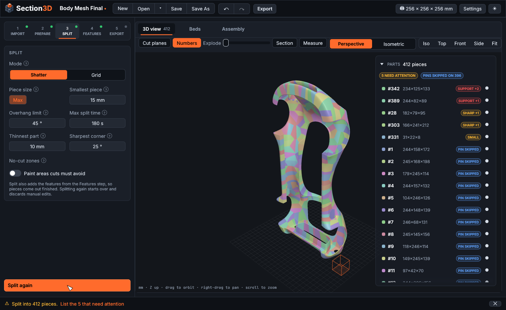
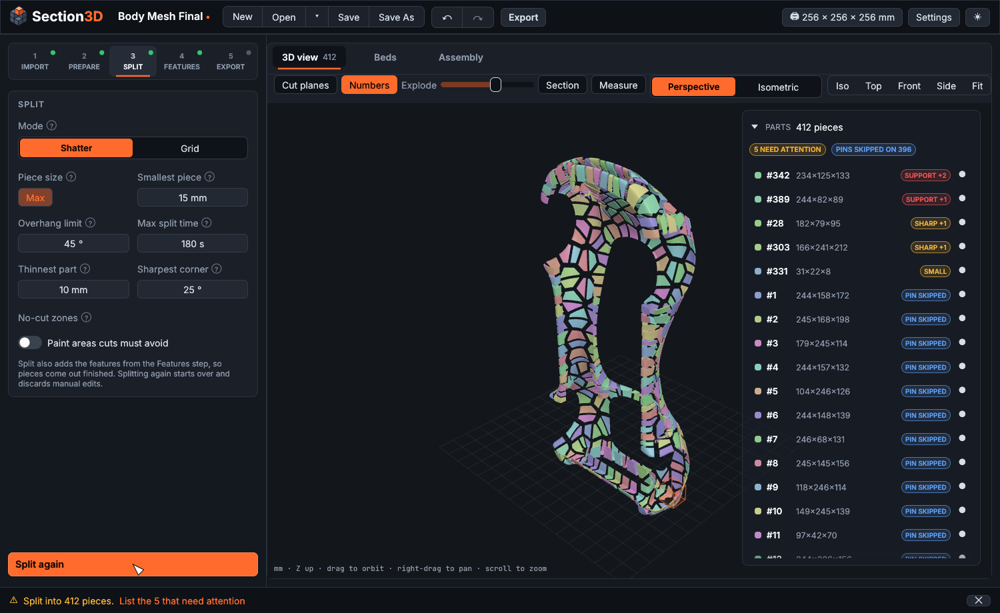
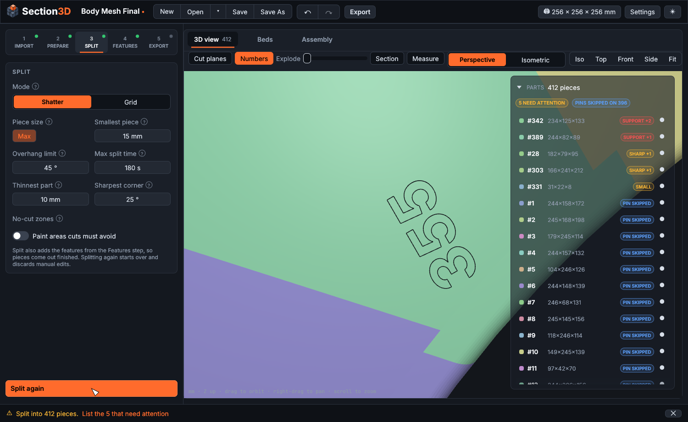
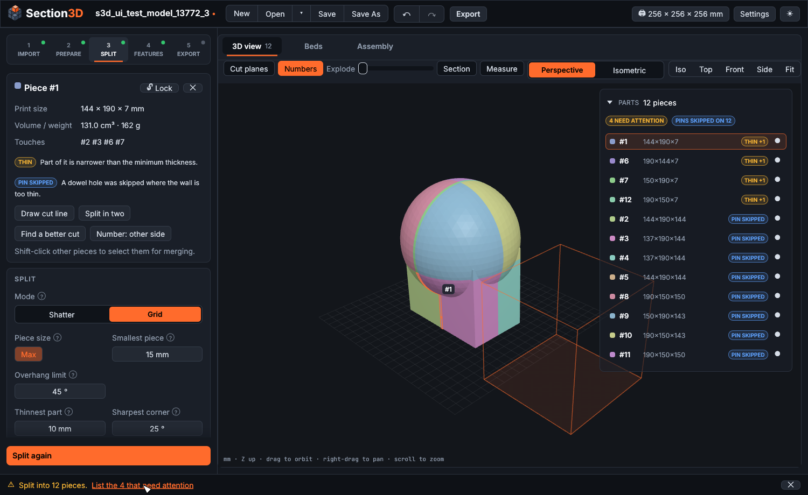
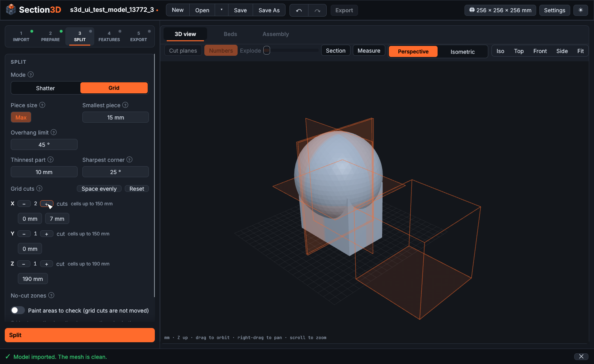
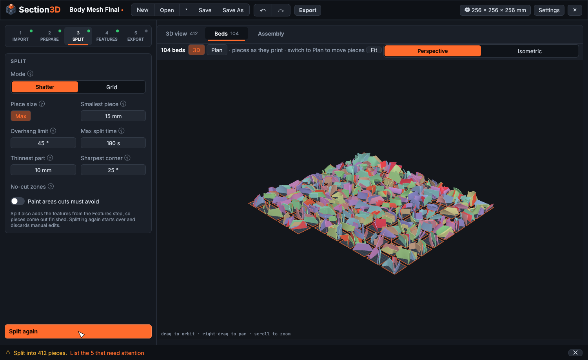
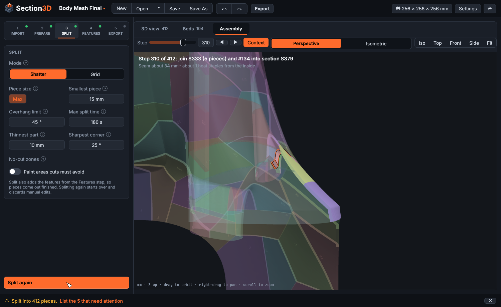

# Section3D

Split a 3D model that is too big for your FDM printer into pieces that each fit the printer, print without
supports, and join back into the original with heat staples, glue or optional dowel pins. Section3D produces print-ready 3MF files
(one per bed), an assembly guide (PDF), a print list (CSV) and an offline 3D viewer (HTML).

It is a single portable program, `section3d.exe` (about 16 MB). It needs no installer and no runtime, and it runs offline.
Download it from [Releases](https://github.com/k-kuehn/Section3D/releases).



## Screenshots

| | |
|---|---|
|  |  |
| Explode the split to see every piece. | Each piece carries its number, raised or cut in. |
|  |  |
| Select a piece to see its size, neighbours and flags; the parts list floats over the view. | Grid mode: set the cuts along each axis. |
|  |  |
| Pieces packed onto as few beds as possible. | The assembly view builds the model up step by step. |

## Workflow

Set your printer's build volume by clicking its size in the top bar (the default is 256 × 256 × 256 mm).

1. **Import**: open an STL, OBJ or 3MF file (or drop it on the window). Broken meshes are repaired
   automatically. If repair fails, the mesh is rebuilt from voxels and you are warned.
2. **Prepare**: rotate, scale, mirror. Optionally hollow the model to a shell (only when you press *Hollow*).
3. **Split**: *Shatter* mode (the default) or *Grid*. *Split* cuts the model and adds the features (pins, part
   numbers) set in the *Features* step in one job.
   - **Shatter mode** cuts a broken-glass pattern: pieces are cells of an even (centroidal Voronoi) layout over the
     surface, so cuts meet the surface square, three pieces meet at each corner at about 120° and no seam runs on in a
     straight line. The pieces are then improved for up to *Max split time* (3 minutes by default) and only while
     that still helps: every piece must fit, print without support, not be tall (its height stays under 0.8× the
     length it stands on), have no corner, tip or cut edge sharper than *Sharpest corner* (25°) and no strip or
     tapering tip thinner than *Thinnest part* (10 mm, measured along the surface, so thin shells are fine). Seams
     that cross in an X, or straight runs longer than about one piece, are merged and divided again at a different
     angle. The cut lines are drawn on the model while the split runs.
   - **Grid mode** cuts with planes square to X, Y and Z. Before cutting, set how many cuts go along each axis and
     where each one is (the planes are drawn on the model; point at a value to highlight its plane). By default they
     are evenly spaced for the piece size. Grid never moves a cut: the pieces are checked and flagged, nothing else.
   - **No-cut zones**: paint areas that cuts must avoid, such as a face or lettering. The paint shows on the surface
     like marker (it covers only the side you paint, not the far side of a thin wall). Shatter keeps every cut face
     out of the paint; Grid flags pieces cut through it.
   - **Select pieces**: click a piece to see its size, neighbours and flags; its edges are outlined. *Shift*-click (or
     *Ctrl*-click) adds or removes pieces, in the 3D view or the parts list; *Merge* joins a touching group into one
     piece. Click the *N need attention* badge to list only the pieces with problems, worst first. The parts list sits
     over the right side of the 3D view, see-through so the model shows behind it; click its arrow (or *Parts*) to fold
     it to its heading. The selected piece's card and the step's settings are in the left panel, with the step's main
     button pinned at the bottom.
   - **Right-click** a group of selected pieces to *Merge* them. Right-click a single piece for *Split* (*Draw a cut
     line…*, *Split in two automatically*, *Find a better cut automatically*), *Move number to the other side*,
     *Isolate*, *Isolate with neighbours*, *Hide* or *Show all*.
   - **Find a better cut** tries, in order: merging the piece with a neighbour and cutting again a little to either
     side of their shared cut; the same with the cut turned; splitting the piece in two or three. It keeps the first
     change that makes the pieces print better.
   - **Draw a cut line**: drag across a piece where you want it cut. The stroke is straightened, the cut starts square
     to the surface, and its angle and position are then adjusted a little where that makes both halves print better.
   - **Manual edits** (merges, cuts, locks) change only the pieces they touch and are listed with the part numbers
     involved; click one to select its pieces. Splitting the whole model again starts over and discards them; *Undo*
     and *Redo* cover every change. Locked pieces are kept through a new split.
4. **Features**: dowel pins (type the diameter and length of the pins you have, or turn pins off), clearance and pins
   per cut, and embossed or debossed part numbers on the *Convex* (outside: facing away from the middle of the model and
   the more open side of a wall) or *Concave* (inside) face of each piece. Every piece gets a number on either side: where
   there is no room the number is turned to run along a narrow strip, then made smaller (down to half size, not under
   3 mm); a piece with no room on either side gets it sunk into a cut face. Right-click a piece to move its number to the other side. The
   numbers are drawn on the pieces in the 3D view (*Numbers* toggle). Pins are optional: holes are drilled square to
   each cut, so you can leave pins out and push parts together. Holes get teardrop or cone tops so they print without
   support. A hole is skipped and flagged where the wall is too thin, and the app suggests a pin size that fits.
5. **Export**: pieces are packed onto as few beds as possible, each resting on a flat face. *Assembly order* is
   *Ordered* (the first beds hold the pieces you join first) or *Random* (whatever fills the beds best). The *Beds*
   tab shows every build plate in 3D with the pieces as they print; switch it to *Plan* to drag pieces between beds
   or right-click one to rotate it. Then write the 3MF beds, optional single STLs, the CSV list, the PDF guide and
   the HTML viewer. You can set file-name templates (`{project}`, `{bed}`, `{part}`) and shrinkage compensation.

The **Assembly** tab, guide and viewer build the model up in sections: each step joins two parts (single pieces
first, then small sections into larger ones) along their seam, with the seam length and a rough count of heat
staples. The part being added is highlighted in place among the others, with a dark-edged outline that slowly pulses from orange to white. The HTML viewer shows the pieces at full
detail with smooth shading.

The 3D views (model and beds) switch between *Perspective* and *Isometric* (parallel) projection.

Changing a setting after a step ran marks that step and the steps after it *out of date*, with an **Update** button.
Nothing re-runs on its own. Long work (splitting, adding features, arranging beds, exporting) runs in the
background; a clock under the 3D view counts up (next to the split's time limit) with **Cancel** beside it.

Projects (`.s3d`) store the model, settings, edit list and results, so opening one never re-cuts. The app autosaves
and offers recovery after a crash.

## Building

Requirements: Rust (stable, MSVC toolchain) and the Visual Studio Build Tools, whose bundled CMake is used to build Manifold.

```
cargo build --release
```

The executable is `target/release/section3d.exe`. It links the C runtime statically, so it needs only Windows
system DLLs. Put a file named `portable` next to the exe to keep settings in a `Section3D-data` folder beside it instead of
`%APPDATA%`.

## Tests

```
cargo test --release --workspace
```

- Unit tests cover geometry and I/O; `crates/s3d-core/tests/requirements.rs` checks the requirements end to end.
- `crates/s3d-app/tests/ui_flows.rs` drives the real UI headlessly through egui_kittest and wgpu, and writes screenshots to
  `target/ui-screens/`.
- Checks on a large real model run when `S3D_SAMPLE` points to an STL (`S3D_SHOTS` and `S3D_EXPORT_DIR` also save
  renders and an export); `S3D_PROJECT` pointing to a saved project checks that every piece takes a part number on
  both sides:

```
S3D_SAMPLE="path/to/model.stl" cargo test --release -p s3d-core --test sample -- --nocapture
S3D_PROJECT="path/to/project.s3d" cargo test --release -p s3d-core --test sample -- --nocapture
```

## Layout

```
crates/s3d-core   geometry: I/O, repair, hollowing, partition and seams, grid and shatter split, quality checks and refinement, orientation,
                  pins and part numbers (features), packing, assembly order, export (3MF, STL, CSV, PDF, HTML), projects
crates/s3d-app    egui/wgpu desktop app: steps, 3D viewport, parts list, beds view, jobs, undo, autosave
assets            logo and icon artwork (tools/ turns it into the app icon)
third_party       vendored Manifold (booleans)
```

License: GPL-3.0-or-later. See `THIRD_PARTY_NOTICES.md` for included components.
